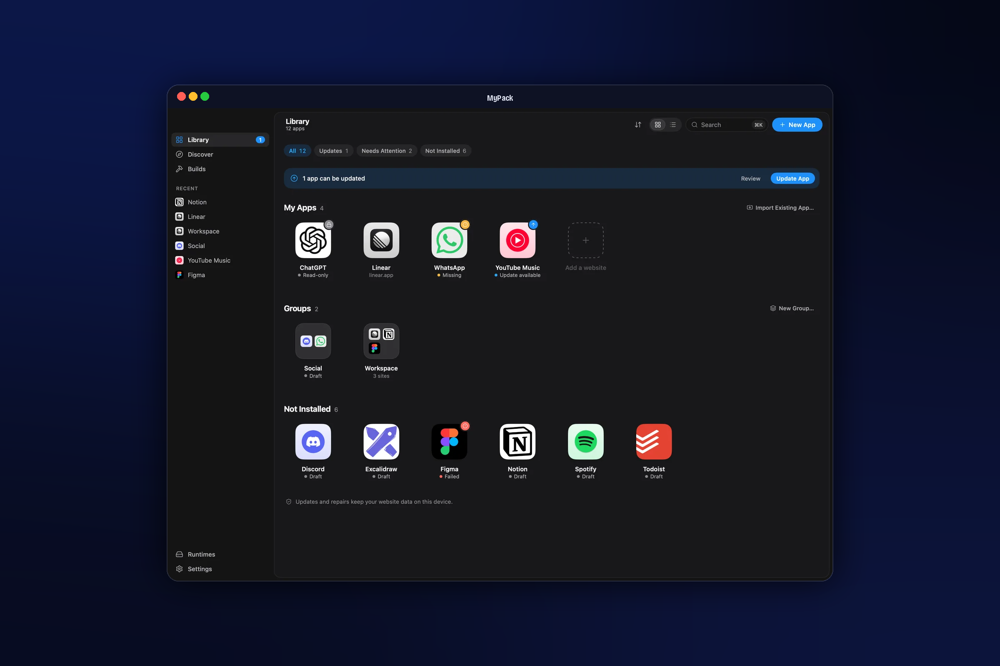

<div align="center">

# MyPack

**どんなWebサイトも。どんなデスクトップも。美しいネイティブビルダーひとつで。**

WebサイトやローカルのHTMLプロジェクトを、数回のクリックで本物の独立したデスクトップアプリにできます。Go、Rust、Node、Xcodeのプロジェクトは不要です。

[](LICENSE)
[](https://github.com/sinhong2011/mypack/actions/workflows/ci.yml)
[](go.mod)

[](CONTRIBUTING.md)
[](https://awesomemygo.dev/apps/mypack)

[English](README.md) · [繁體中文](README.zh-TW.md) · [简体中文](README.zh-CN.md) · [粵語](README.yue.md) · [Español](README.es.md) · [Français](README.fr.md) · **日本語**

[機能](#機能) · [はじめ方](#はじめ方) · [CLIとエージェント](#cliとaiエージェント) · [コントリビューション](#コントリビューション) · [着想](#着想と謝辞)



</div>

```
URLを貼る  →  名前とアイコンを確認  →  ビルド  →  インストールして開く
```

MyPack は [Apache License 2.0](LICENSE) の下で無料のオープンソースです。
機能はすべて含まれています。アプリ数の制限、ライセンスキー、アカウントは不要です。

## なぜ MyPack なのか

私たちの仕事の多くはWebアプリの中にありますが、ブラウザのタブはそれらの居場所としては不向きです。
タブは他のタブに埋もれ、どのサイトも同じcookieを共有し、どれも独自のDockアイコン、通知、ウィンドウを持ちません。

MyPack は各サイトに本物の専用アプリを与え、その後も世話を続けます。

- **マシンにツールチェーンは不要です。** MyPack は何もコンパイルしません。小型の事前ビルド済みruntimeを使い、アプリの設定を書き込むだけなので、ビルドは数秒で終わります。
- **アプリは単体で成り立ちます。** どのアプリも独自の名前、アイコン、分離されたログインを持ち、システムのWebViewを使い、MyPack をアンインストールしても動き続けます。
- **作って終わりではありません。** ログインを失わずにワンクリックでアプリをアップデートでき（アップデートに失敗すれば前のバージョンに戻ります）、修復したり、別のコンピュータへ移したりできます。

## 機能

**アプリを作る**

- 🌐 **任意のWebサイトから**：MyPack が名前と最適なアイコンを取得します。どちらも変更でき、アイコンスタジオでアイコンをデザインすることもできます。
- 📁 **ローカルプロジェクトから**：HTMLファイル、`index.html` を含むフォルダ、または Vite、CRA、Astro、Nuxt、SvelteKit、Next のエクスポート。MyPack はまずプロジェクトのビルドを実行しますが、あなたが承認したあとだけです。
- 🧭 **見つける**：人気サイトが数十あり、ワンクリックで始められます。リストは誰でも追加できるシンプルな [JSONファイル](catalog/discover.json) です。
- 🗂️ **グループアプリ**：複数のサイトを1つのウィンドウにまとめ、サイドレール、サイトごとの独立したセッション、分割ビューを備えます。
- 📥 **Pake 設定**：お持ちの [Pake](https://github.com/tw93/Pake) の `pake.json` をそのまま持って来られます。

**作ったアプリの中で**

- 🔔 Web通知と、未読数のDockバッジ
- 🎵 音楽・動画サイトでメディアキーと「再生中」表示（macOSとLinux。Windowsは標準で対応）
- 🔗 MyPack アプリ同士のリンクは、正しいアプリで開きます
- 🪟 ウィンドウモード：ウインドウ、コンパクト、サイドバー、またはメニューバー
- 📑 タブとページのピン留め
- 🛡️ コンテンツブロッキング、カスタムCSSとJavaScript、proxyとuser-agentの設定
- 🔑 ログイン用ポップアップ（Google、Microsoft など）がそのまま動作します

**管理する**

- 📚 作ったものをすべて収めるライブラリ。インストールして開く、アップデート、修復、アンインストールに対応
- 🔄 iCloud Drive のような共有フォルダを通じたコンピュータ間のライブラリ同期、または `.mypack` ファイルの書き出しと読み込み
- 🧩 表示中のタブをアプリにする、任意のブラウザ拡張機能
- 🌏 7つの言語：English、繁體中文、简体中文、粵語、Español、Français、日本語

**開発者とAIエージェント向け**

- ⌨️ `--json` 出力と安定した終了コードを持つヘッドレスCLI
- 🤖 組み込みの [MCP](https://modelcontextprotocol.io) サーバー。Claude Code、Codex などのエージェントがアプリの作成とビルドを行えます。MyPack 自体にチャットやLLMは内蔵されていません。

## 仕組み

```
               ┌───────────── MyPack（ビルダー） ─────────────┐
  Webサイト /  │  名前とアイコン  →  mypack.json  →  アプリ組み立て │      あなたのアプリ
  フォルダ ──▶ │                                       ▲        │ ──▶  .app / .exe /
               └───────────────────────────────────────┼────────┘      Linuxフォルダ
                                                       │
                          事前ビルド済みruntime。署名付き（Ed25519）
                          レジストリから一度だけダウンロードし、検証してキャッシュします
```

runtime はプラットフォームごとに1つの小さなバイナリで、特定のWebサイトについては何も知りません。MyPack はそれをコピーし、アプリの名前、アイコン、`mypack.json` を加え、macOS では結果に署名します。詳細は
[ARCHITECTURE.md](ARCHITECTURE.md) にあります。

| | MyPack（ビルダー） | 作られるアプリ |
|---|---|---|
| **macOS**（Apple silicon と Intel） | ✅ メインのプラットフォーム。`.app` / `.dmg` としてパッケージ化 | ✅ WKWebView |
| **Linux**（x64 と arm64） | 🧪 ソースからビルド | ✅ WebKitGTK、Ubuntu 24.04 でテスト済み |
| **Windows**（x64 と arm64） | 🧪 ソースからビルド | 🧪 WebView2、テストは少なめ |

## はじめ方

### インストール

**macOS**（[Homebrew](https://brew.sh)）：

```sh
brew install --cask sinhong2011/tap/mypack
```

**Windows**（winget、[Scoop](https://scoop.sh)、[Chocolatey](https://chocolatey.org)）：

```powershell
winget install MyPack.MyPack
```

```powershell
scoop bucket add mypack https://github.com/sinhong2011/scoop-bucket
scoop install mypack/mypack
```

```powershell
choco install mypack
```

**Debian と Ubuntu**（APT）：

```sh
curl -fsSL https://sinhong2011.github.io/mypack/mypack.gpg | sudo tee /usr/share/keyrings/mypack.gpg >/dev/null
echo "deb [signed-by=/usr/share/keyrings/mypack.gpg] https://sinhong2011.github.io/mypack/apt stable main" | sudo tee /etc/apt/sources.list.d/mypack.list
sudo apt update && sudo apt install mypack
```

**Fedora、RHEL、openSUSE**（DNF、YUM、Zypper）：

```sh
sudo curl -fsSL -o /etc/yum.repos.d/mypack.repo https://sinhong2011.github.io/mypack/rpm/mypack.repo
sudo dnf install mypack        # sudo zypper install mypack
```

**Arch Linux**（[AUR](https://aur.archlinux.org/packages/mypack-bin)）：

```sh
yay -S mypack-bin
```

各 [Release](https://github.com/sinhong2011/mypack/releases/latest) には直接ダウンロードできるインストーラーもあります：macOS 用の `.dmg`、Windows 用のセットアッププログラム、Linux 用の `.deb` と `.rpm`。パッケージマネージャーでインストールすると `mypack` コマンドが PATH に入り、そのマネージャーのアップグレードコマンドで更新できます。

> [!NOTE]
> リリースはまだ署名されていません。macOS で Gatekeeper に初回起動をブロックされたら、MyPack.app を右クリックして「開く」を選んでください。Windows では SmartScreen が確認を求めることがあります（「詳細情報 › 実行」）。

### ソースからビルドする

Go 1.27.3 以降が必要です。`GOTOOLCHAIN=auto`（デフォルト）なら、Go が適切なバージョンを取得します。

```sh
git clone https://github.com/sinhong2011/mypack.git
cd mypack
make runtimes   # build the app runtimes and sign them with a local dev key
make app        # build dist/MyPack.app (macOS)
open dist/MyPack.app
```

`make dmg` は Applications にドラッグできるディスクイメージも作ります。何もビルドせずに眺めるだけなら、`make run-fake` がデモデータでアプリを起動します。

### 最初のアプリを作る

1. **新規アプリ**（⌘N）をクリックし、たとえば `github.com` のようなアドレスを貼り付けます。
2. 名前とアイコンを確認します。
3. **ビルド** をクリックし、次に **インストールして開く** をクリックします。

HTMLファイルやフォルダをウィンドウにドロップしたり、**見つける** でサイトを選んだりすることもできます。

## CLIとAIエージェント

アプリのバイナリはそのまま CLI でもあります。

```sh
alias mypack=/Applications/MyPack.app/Contents/MacOS/MyPack   # not needed after a package-manager install

mypack create github.com --json          # a draft project; nothing is built yet
mypack build <project-id> --yes --json   # build it (--yes allows the runtime download)
mypack install <artifact-id> --open
mypack apps list
```

`--json` を付けると、各コマンドはJSONオブジェクトを1つ出力します。終了コードは安定しています。`0` 成功、`1` エラー、`2` 使い方、`3` 入力が無効、`4` runtime またはネットワーク、`5` ビルド失敗、`6` 承認が必要、`130` キャンセル。すべてのコマンドは `mypack help` で確認できます。

**MCPサーバー。** 次のようにエージェントを接続します。

```sh
claude mcp add mypack -- mypack mcp serve
```

アプリの **設定 › エージェント接続** には、Claude Code、Codex、その他のMCPクライアント向けにコピーできる設定があります。エージェントはプロジェクトの一覧、作成、ビルドができますが、アプリのインストールはできず、プロジェクトのビルドスクリプトはあなたが承認したあとだけ実行されます。

**ブラウザ拡張機能（任意）。** [docs/companion.md](docs/companion.md) を参照してください。

## プロジェクト構成

```
cmd/          エントリポイント：アプリ、CLI、ブラウザの native-messaging host
runtime/      MyPack が作る各アプリに入る runtime
internal/     ビルダー、インストーラー、サービス、ストレージ、CLI、MCPサーバー、アプリのUI
pkg/config/   mypack.json 形式（および Pake のインポート）
catalog/      見つける用カタログ、discover.json
apps/         ブラウザ拡張機能（WXT + SolidJS）
```

## コントリビューション

大小を問わず、貢献を歓迎します。

- **見つけるにサイトを追加する**：[`catalog/discover.json`](catalog/discover.json) を編集します。
  リリースを待たず、1日以内にすべてのユーザーへ届きます。
- **うまく動かないサイトを報告する**：*Website compatibility* の issue フォームを使ってください。
- **Linux と Windows でテストする**：今いちばん助けが必要なところです。
- **翻訳、バグ修正、ドキュメントの改善。**

まず [CONTRIBUTING.md](CONTRIBUTING.md) から始めてください。セキュリティ上の問題は [SECURITY.md](SECURITY.md) の手順に従って非公開で報告し、
[Code of Conduct](CODE_OF_CONDUCT.md) に従ってください。

## 着想と謝辞

MyPack は次の2つのプロジェクトの肩の上に立っています。

- **[Pake](https://github.com/tw93/Pake)**（[tw93](https://github.com/tw93) 作）
  は、Webサイトが小さく焦点の定まったデスクトップアプリとしてどれほどうまく感じられるか、そしてそれを求める人がどれだけ多いかを示しました。MyPack は同じ発想を別のやり方で実現します。ビルド用ツールチェーンの代わりに事前ビルド済みruntimeを使い、アプリを作り、長く面倒を見るためのネイティブアプリを提供します。Pake の設定を読み込めるので、既存の設定を持って来られます。
- **[MyGo](https://github.com/egoist/mygo)**（[egoist](https://github.com/egoist) 作）
  は、MyPack のインターフェースと、それが作るアプリの背後にある純GoのネイティブUIツールキットです。Electron も、Webフロントエンドも、cgo もありません。

アイコンを提供してくれた [Lucide](https://lucide.dev) と、
[modernc.org/sqlite](https://gitlab.com/cznic/sqlite) にも感謝します。第三者に関する通知はすべて
[NOTICE](NOTICE) にあります。

## ライセンス

MyPack は [Apache License 2.0](LICENSE) の下でライセンスされています。

「MyPack」という名称とそのロゴは商標であり、コードのライセンスの対象外です。改変したビルドを配布する場合は、別の名前とアイコンを付けてください。[TRADEMARKS.md](TRADEMARKS.md) を参照してください。ビルドを配布するフォークは、独自のruntimeレジストリをホストし、独自の鍵で署名する必要があります。
