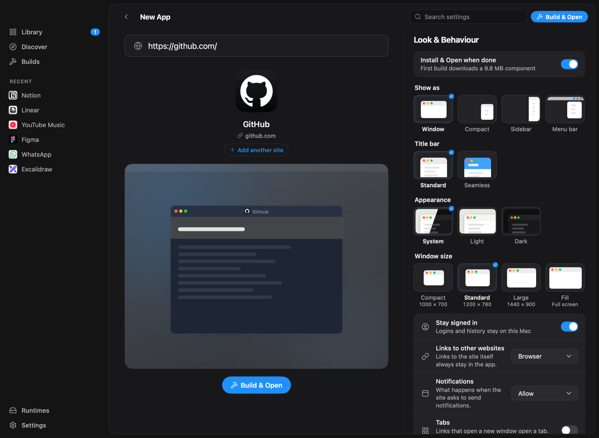
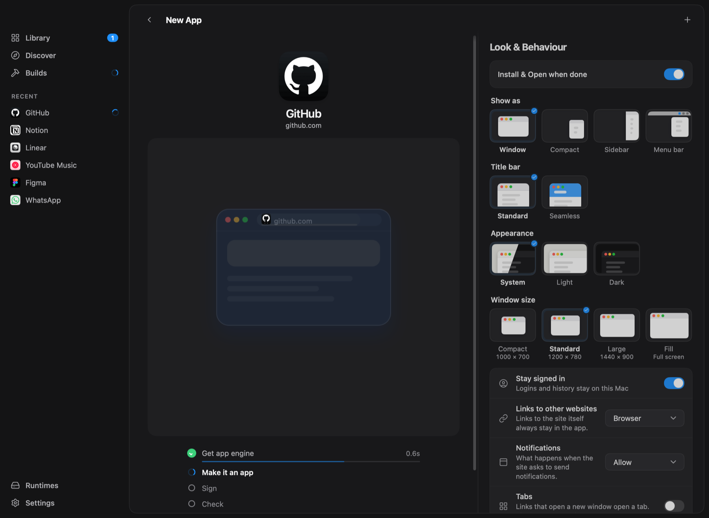
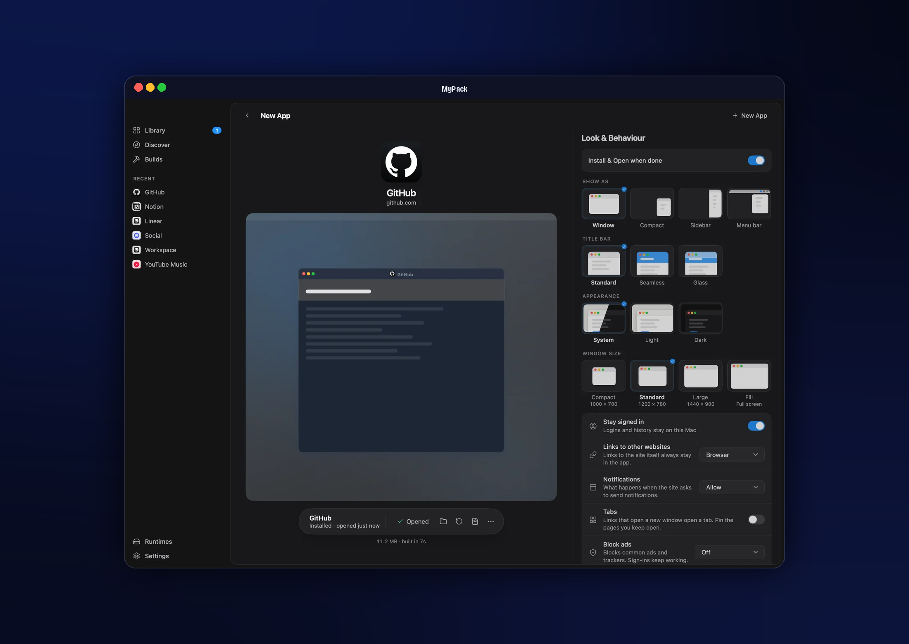
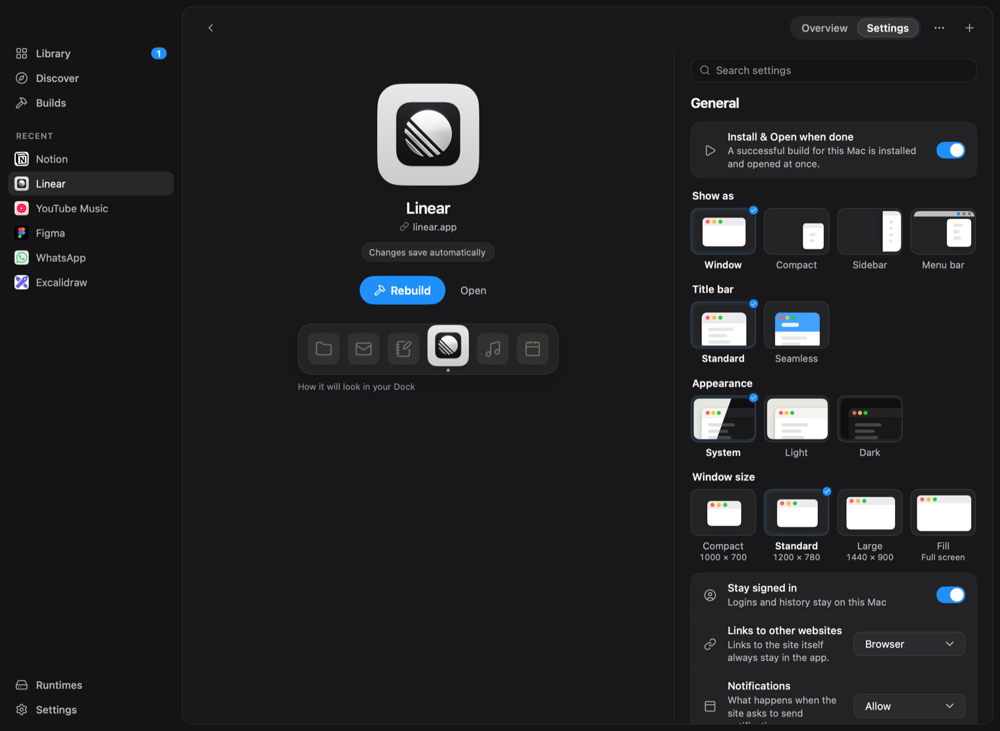
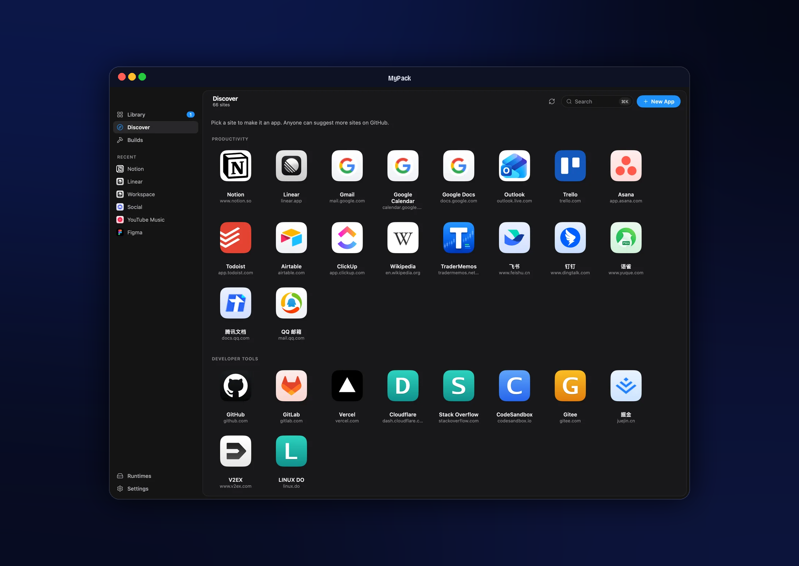
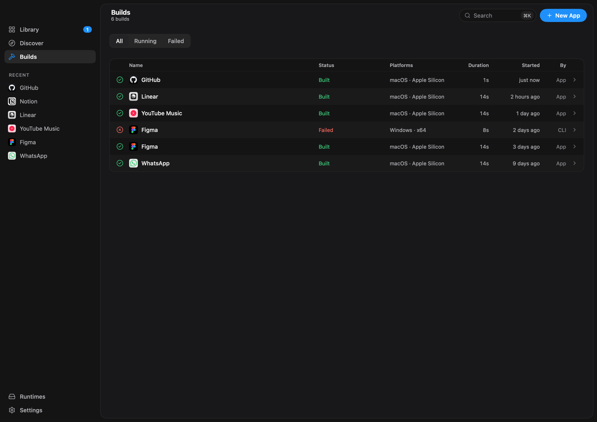
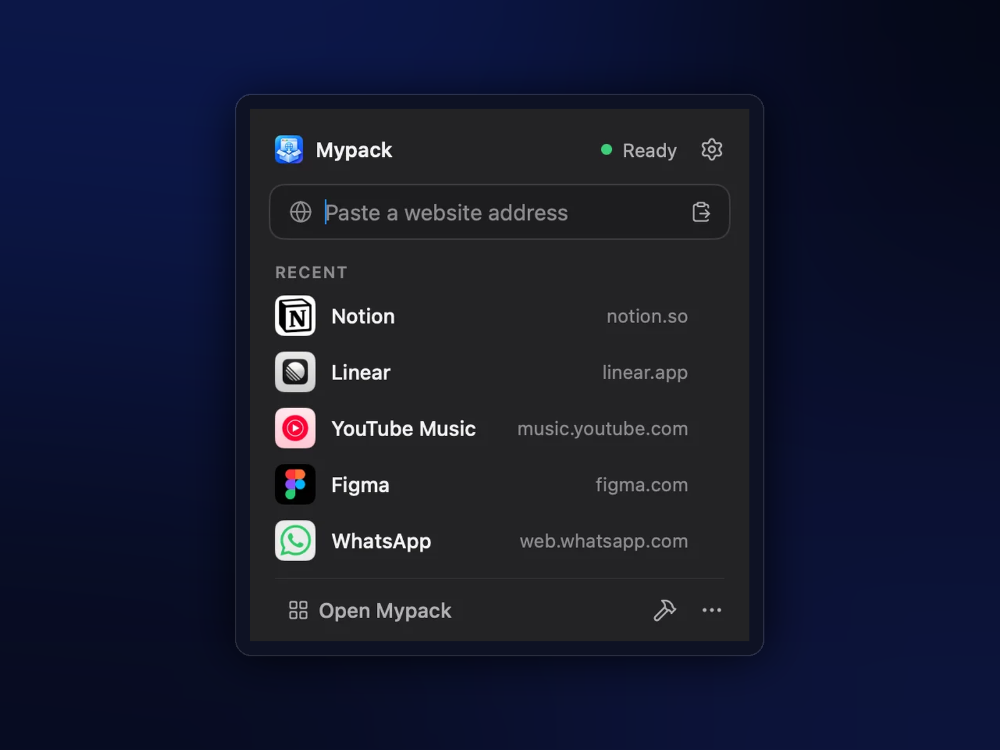

<div align="center">

# Mypack

**Any website. Any desktop. One beautiful native builder.**

Turn a website, or a local HTML project, into a real, standalone desktop app
in a few clicks. No Go, Rust, Node or Xcode project required.

[](LICENSE)
[](https://github.com/sinhong2011/mypack/actions/workflows/ci.yml)
[](go.mod)

[](CONTRIBUTING.md)

**English** · [繁體中文](README.zh-TW.md) · [简体中文](README.zh-CN.md) · [粵語](README.yue.md) · [Español](README.es.md) · [Français](README.fr.md) · [日本語](README.ja.md)

[Features](#features) · [Getting started](#getting-started) · [CLI & agents](#cli-and-ai-agents) · [Contributing](#contributing) · [Inspiration](#inspiration-and-thanks)


</div>

```
Paste a URL  →  confirm name & icon  →  Build  →  Install & Open
```

Mypack is free and open source under the [Apache License 2.0](LICENSE).
Every feature is included: no app limits, no license keys, no account.

## Why Mypack?

A lot of our work lives in web apps, but a browser tab is a poor home for them.
Tabs get lost among other tabs, every site shares one set of cookies, and none
of them get their own Dock icon, notifications or window.

Mypack gives each site a proper app of its own, and then keeps looking after it:

- **No toolchain on your machine.** Mypack doesn't compile anything. It uses a
  small prebuilt runtime and writes your app's settings into it, so a build
  takes seconds.
- **Apps that stand on their own.** Every app has its own name, icon and
  separate sign-in, uses the system WebView, and keeps working if you uninstall
  Mypack.
- **Looked after, not just made.** Update an app in one click without losing
  your logins (if an update fails, the previous version comes back), repair it,
  or move it to another computer.

## Features

**Making apps**

- 🌐 **From any website**: Mypack fetches the name and the best icon. You can
  change both, or design an icon in the Icon Studio.
- 📁 **From local projects**: an HTML file, a folder with `index.html`, or a
  Vite, CRA, Astro, Nuxt, SvelteKit or Next export. Mypack runs the project's
  build first, but only after you approve it.
- 🧭 **Discover**: dozens of popular sites, one click to start. The list is a
  plain [JSON file](catalog/discover.json) that anyone can add to.
- 🗂️ **Group apps**: several sites in one window, with a side rail, a
  separate session per site and split view.
- 📥 **Pake configs**: bring your [Pake](https://github.com/tw93/Pake)
  `pake.json` along.

**Inside the apps you make**

- 🔔 Web notifications and a Dock badge for unread counts
- 🔗 Links between your Mypack apps open in the right app
- 🪟 Window modes: normal, compact, sidebar, or in the menu bar
- 📑 Tabs with pinned pages
- 🛡️ Content blocking, custom CSS and JavaScript, proxy and user-agent settings
- 🔑 Sign-in pop-ups (Google, Microsoft and others) that just work

**Managing them**

- 📚 A Library of everything you made, with Install & Open, Update, Repair and
  Uninstall
- 🔄 Library sync across computers through a shared folder such as iCloud
  Drive, or export and import `.mypack` files
- 🧩 An optional browser extension that turns the tab you're on into an app
- 🌏 Seven languages: English, 繁體中文, 简体中文, 粵語, Español, Français,
  日本語

**For developers and AI agents**

- ⌨️ A headless CLI with `--json` output and stable exit codes
- 🤖 A built-in [MCP](https://modelcontextprotocol.io) server, so Claude Code,
  Codex and other agents can create and build apps for you. Mypack itself has
  no built-in chat or LLM.

## A look around

<table>
  <tr>
    <td width="50%"></td>
    <td width="50%"></td>
  </tr>
  <tr>
    <td align="center"><b>New App</b>: paste an address, check the name and icon, choose a window style</td>
    <td align="center"><b>Build</b>: a few seconds, every step shown</td>
  </tr>
  <tr>
    <td></td>
    <td></td>
  </tr>
  <tr>
    <td align="center"><b>Done</b>: installed and opened in one click</td>
    <td align="center"><b>App settings</b>: window mode, title bar, appearance, and how it looks in your Dock</td>
  </tr>
  <tr>
    <td></td>
    <td></td>
  </tr>
  <tr>
    <td align="center"><b>Discover</b>: popular sites, one click to start</td>
    <td align="center"><b>Builds</b>: every build, from the app, the CLI or an agent</td>
  </tr>
</table>

<p align="center">
  
  <br>
  <b>Menu bar</b>: paste an address, jump to a recent app, follow builds without opening the window
</p>

## How it works

```
               ┌───────────── Mypack (the builder) ─────────────┐
  website /    │  name & icon  →  mypack.json  →  assemble app  │      your app
  folder   ──▶ │                                       ▲        │ ──▶  .app / .exe /
               └───────────────────────────────────────┼────────┘      Linux folder
                                                       │
                          prebuilt runtime, downloaded once from a
                          signed (Ed25519) registry, verified and cached
```

The runtime is one small binary per platform that knows nothing about any
particular website. Mypack copies it, adds your app's name, icon and
`mypack.json`, and on macOS signs the result. The details are in
[ARCHITECTURE.md](ARCHITECTURE.md).

| | Mypack (the builder) | Apps it makes |
|---|---|---|
| **macOS** (Apple silicon & Intel) | ✅ Main platform, packaged as `.app` / `.dmg` | ✅ WKWebView |
| **Linux** (x64 & arm64) | 🧪 Build from source | ✅ WebKitGTK, tested on Ubuntu 24.04 |
| **Windows** (x64 & arm64) | 🧪 Build from source | 🧪 WebView2, less tested |

## Getting started

> [!NOTE]
> Mypack is young, and signed releases are on the way. Until then, build it
> from source. It takes about a minute.

### Build from source

You need Go 1.27.3 or newer. With `GOTOOLCHAIN=auto` (the default), Go fetches
the right version for you.

```sh
git clone https://github.com/sinhong2011/mypack.git
cd mypack
make runtimes   # build the app runtimes and sign them with a local dev key
make app        # build dist/Mypack.app (macOS)
open dist/Mypack.app
```

`make dmg` also makes a drag-to-Applications disk image. To look around
without building anything, `make run-fake` starts the app with demo data.

### Make your first app

1. Click **New App** (⌘N) and paste an address, for example `github.com`.
2. Check the name and icon.
3. Click **Build**, then **Install & Open**.

You can also drop an HTML file or a folder onto the window, or pick a site in
**Discover**.

## CLI and AI agents

The app's binary is also the CLI:

```sh
alias mypack=/Applications/Mypack.app/Contents/MacOS/mypack

mypack create github.com --json          # a draft project; nothing is built yet
mypack build <project-id> --yes --json   # build it (--yes allows the runtime download)
mypack install <artifact-id> --open
mypack apps list
```

With `--json`, every command prints one JSON object. Exit codes are stable: `0`
ok, `1` error, `2` usage, `3` invalid input, `4` runtime or network, `5` build
failed, `6` approval required, `130` cancelled. Run `mypack help` for every
command.

**MCP server.** Connect an agent with:

```sh
claude mcp add mypack -- /Applications/Mypack.app/Contents/MacOS/mypack mcp serve
```

**Settings › Agent Connections** in the app has ready-to-copy setups for Claude
Code, Codex and other MCP clients. Agents can list, create and build projects,
but they can't install apps, and a project's build script only runs after you
approve it.

**Browser extension (optional).** See [docs/companion.md](docs/companion.md).

## Project layout

```
cmd/          entry points: the app, the CLI, the browser native-messaging host
runtime/      the runtime inside every app Mypack makes
internal/     builder, installer, service, storage, CLI, MCP server and the app's UI
pkg/config/   the mypack.json format (and Pake import)
catalog/      the Discover catalog, discover.json
apps/         the browser extension (WXT + SolidJS)
```

## Releases

A release is a `vX.Y.Z` tag pushed on `main`. The Release workflow tests that commit, then GoReleaser builds unsigned binaries for macOS, Linux and Windows and publishes them, with checksums, to a GitHub Release whose notes list the pull requests merged since the last one. `mygo build` adds installers to the same Release: a macOS disk image, Windows setup programs, and Debian and RPM packages. Discover catalog edits reach users without a release. Signed macOS builds and Homebrew are not part of this pipeline yet; [docs/releasing.md](docs/releasing.md) lists what they need.

## Contributing

Contributions of every size are welcome:

- **Add a site to Discover**: edit [`catalog/discover.json`](catalog/discover.json).
  It reaches every user within a day, no release needed.
- **Report a site that misbehaves** with the *Website compatibility* issue form.
- **Test on Linux and Windows**: this is where help matters most right now.
- **Translate, fix bugs, improve the docs.**

Start with [CONTRIBUTING.md](CONTRIBUTING.md). Please report security problems
privately as described in [SECURITY.md](SECURITY.md), and follow the
[Code of Conduct](CODE_OF_CONDUCT.md).

## Inspiration and thanks

Mypack stands on the shoulders of two projects:

- **[Pake](https://github.com/tw93/Pake)** by [tw93](https://github.com/tw93)
  showed how good a website can feel as a small, focused desktop app, and how
  many people want that. Mypack takes the same idea a different way: a
  prebuilt runtime instead of a build toolchain, and a native app for making
  and looking after your apps over time. It reads Pake configs, so you can
  bring yours along.
- **[MyGo](https://github.com/egoist/mygo)** by [egoist](https://github.com/egoist)
  is the pure-Go native UI toolkit behind Mypack's interface and the apps it
  makes: no Electron, no web front end, no cgo.

Thanks also to [Lucide](https://lucide.dev) for the icons and to
[modernc.org/sqlite](https://gitlab.com/cznic/sqlite). All third-party notices
are in [NOTICE](NOTICE).

## License

Mypack is licensed under the [Apache License 2.0](LICENSE).

The name "Mypack" and its logo are trademarks and aren't covered by the code
license. If you distribute a modified build, please give it a different name
and icon; see [TRADEMARKS.md](TRADEMARKS.md). Forks that distribute builds
should host their own runtime registry and sign it with their own key.
